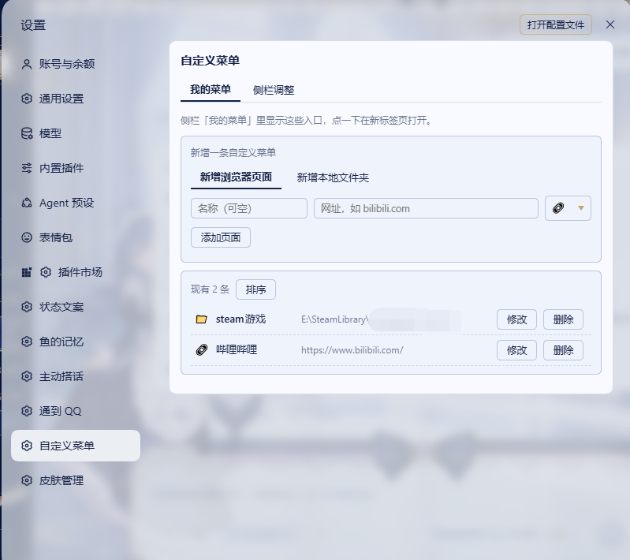
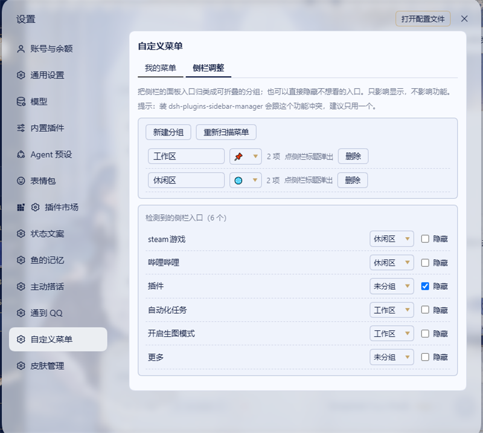
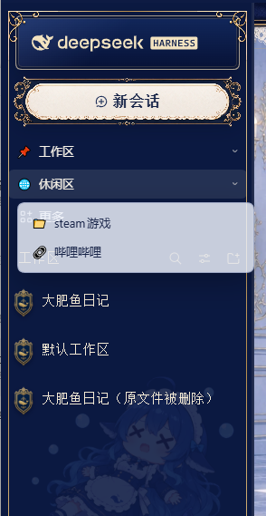

# dsh-custom-menu

**侧栏启动器：把网页和本地文件夹钉在 DSH 左侧栏。**
**Sidebar launcher for DeepSeek Harness: pin web pages and local folders to the sidebar.**

在左侧栏加上你自己的入口，点一下：网页在新标签页打开，**本地文件夹直接用资源管理器弹出来**。顺带可以把自带菜单分组、隐藏掉不用的那些。

Add your own rows to the DSH sidebar. One click opens a web page in a new tab, or **opens a local folder in your file manager**. Built-in entries can be grouped and hidden as well.

---

## 为什么还做一个 / Why another sidebar plugin

侧栏整理这一格已经有人占着了：排序、分组、隐藏、按钮行布局、溢出收进「更多」，市场里都有更完整的实现（见文末 [边界](#scope--边界)）。但有一件事一直空着——**把本地文件夹钉上侧栏，点一下就打开**。

Sidebar organizers already exist (sorting, grouping, hiding, layout modes, overflow into “More”), and bookmarks docks exist for URLs. What was missing: **a one-click shortcut to a local folder**. That is the first feature here, not an afterthought.

第二个边界：**不做内嵌浏览**。很多站点要么 `X-Frame-Options: DENY`，要么登录态在 iframe 里直接失效，嵌在面板里显示的结果是白屏或未登录。这里只负责「打开」，把页面交回浏览器。

Second scope decision: **no embedded browsing**. Sites that refuse framing or need sign-in break inside an iframe. This plugin only *opens* things.

---

## Screenshots / 截图

**自定义菜单 / Custom entries**



**侧栏调整 / Sidebar adjustment**



**分组浮层与整理后的侧栏 / Group popover and the organized sidebar**

<p>
  
  
</p>

---

## Features / 功能

### 1. 本地文件夹直达 / Local folder shortcuts

把任意目录钉进侧栏，点一下就弹出系统文件管理器。

Pin any directory to the sidebar; clicking it opens your file manager at that path.

- 支持 `D:\照片`、`D:/work`、`\\nas\share\项目` 这类绝对路径（UNC 也可以）
- Windows 用 `explorer.exe`，macOS 用 `open`，Linux 用 `xdg-open`
- 路径不存在时不会静默失败，会在条目上给出提示
- 新建条目默认就是文件夹模式，图标默认 📁，改地址不用改图标

### 2. 网页入口 / Web shortcuts

`https://…` 在新标签页打开。地址栏会被限宽，长链接不会把侧栏撑开。

`https://…` opens in a new tab. Long URLs are truncated in the row, so they cannot stretch the sidebar.

### 3. 每个条目都能就地改 / Edit in place

名称、地址、图标随时改，不用删了重建。图标可以直接填 emoji 或图片 URL。

Name, address and icon are editable inline after creation. The icon accepts an emoji or an image URL.

### 4. 拖动排序 / Drag to reorder

点「排序」进入拖动模式，抓住 ⠿ 直接拖，松手即生效；再点一下退出。

Toggle「排序」, drag by the ⠿ handle, and the new order is saved on drop.

### 5. 分组自带菜单 / Group built-in entries

把自带菜单项归进可折叠的分组，分组可以自定义名称和图标；点分组弹出浮层列出组内条目（行为和自带的「更多」一致）。

Group built-in entries under a custom name and icon; clicking a group opens a popover listing its entries.

### 6. 隐藏不用的入口 / Hide entries

单独隐藏用不上的菜单项，只影响显示，功能照旧可达。

Hide individual entries you never use. Hidden entries stay functional and reachable elsewhere.

### 7. 「更多」固定最后 / “More” stays last

自带的「更多」入口始终排在侧栏末尾，分组标题按顺序插在它前面。

The built-in “More” row is always pinned to the end of the column.

---

## Install / 安装

```powershell
dsh plugin --profile desktop add github:tan90tan90/dsh-custom-menu
```

装完**重启 DSH**，然后在 **设置 → 自定义菜单** 里加条目。

After installing, **restart DSH**, then open **Settings → 自定义菜单**.

---

## How it works / 实现说明

- 设置页通过宿主的 `settings.section` 槽注册，客户端用官方的 `window.__ModuleLoader__.load` 约定加载。
- 侧栏行是「装饰」出来的，不是搬动机有的 React 节点：插件把自己的行作为面板列的直接子节点追加，隐藏用 `display: none`，排序在自己插入的节点之间用 DOM 顺序完成（该列不是 flex 容器，CSS `order` 无效）。`MutationObserver` 在宿主重渲染后补写，并带内容签名与自身写入的抑制标记，避免反复插入。
- **打开本地文件夹走宿主路由 `POST /dsh-custom-menu/open`**：只接受绝对路径（`^[A-Za-z]:[\\/]` 或 UNC），先 `existsSync` 校验再启动进程，参数以数组传递、不经过 shell，没有拼接注入的空间。Windows 上 `explorer.exe` 成功时也可能返回退出码 1，所以**只判定进程是否启动，不看退出码**。
- 所有配置都存在浏览器 `localStorage`，插件不往 DSH 的 profile 文件里写任何东西。

- Opening a local folder goes through a host route. Only absolute paths are accepted, the path must exist, arguments are passed as an array (no shell interpolation). On Windows `explorer.exe` can return exit code 1 even on success, so the spawn is treated as fire-and-forget.
- Config lives in `localStorage`; nothing is written into DSH profile files.

---

## Requirements

- DSH desktop with a web-based client
- Windows / macOS / Linux

---

## Known limitations

- 侧栏行按标签定位，DSH 大改侧栏结构时可能需要调整 `lib/client.js` 里的 `KNOWN_LABELS`。
- 只支持 `http(s)` 链接和绝对本地路径，不支持自定义 URI scheme。
- 隐藏只是视觉隐藏，被隐藏的入口仍然可以经由它自己的菜单位置访问。
- 不做内嵌浏览：点开就是交给外部浏览器或系统文件管理器。

---

## Scope / 边界

这个插件**不是**一个完整的侧栏菜单编辑器。如果你要的是顶栏一起管、按钮行/列表布局、行数上限、溢出收纳、Agent 可调接口，市场里有更完整的实现：

- [1499501762/dsh-sidebar-manager](https://github.com/1499501762/dsh-sidebar-manager) — 侧栏 + 顶栏菜单编辑器，排序/分组/图标/隐藏/拖拽 + `window.__dshSidebarManager`
- [devome/dsh-panel-layout](https://github.com/devome/dsh-panel-layout) — 面板菜单布局、按钮行行数、拖动排序、溢出收进「更多」
- [@qzsy/dsh-custom-pages](https://www.npmjs.com/package/@qzsy/dsh-custom-pages) — 侧栏自定义页，网页内嵌在面板里打开，支持登录站点转右侧浏览器

本插件的定位只有一条：**把入口钉上去，点一下就打开，包括本地文件夹。**

This plugin is deliberately scoped: pin entries, open them on click — local folders included. For full sidebar/top-bar menu editing, use the plugins above.

---

## Credits / 致谢

The sidebar grouping approach borrows its idea from [HighToward/dsh-plugins-sidebar-manager](https://github.com/HighToward/dsh-plugins-sidebar-manager): rather than moving nodes that React owns, decorate the rendered column (self-inserted group titles, `display: none` for hidden rows). No code was copied; the implementation here is written independently.

侧栏分组的实现思路借鉴了 [HighToward/dsh-plugins-sidebar-manager](https://github.com/HighToward/dsh-plugins-sidebar-manager)：不移动 React 拥有的节点，改用 DOM 装饰（自插标题行、`display:none`）实现分组与隐藏。未复制其代码，本插件为独立实现。

The settings-page registration follows the `settings.section` slot usage documented by [Yuuyuko-uu/dsh-speak-up](https://github.com/Yuuyuko-uu/dsh-speak-up) and DSH's own `window.__ModuleLoader__.load` client-side convention.

设置页的注册方式参考了 [Yuuyuko-uu/dsh-speak-up](https://github.com/Yuuyuko-uu/dsh-speak-up) 的 `settings.section` 用法，以及 DSH 官方的 `window.__ModuleLoader__.load` 客户端加载约定。

---

## License

MIT
